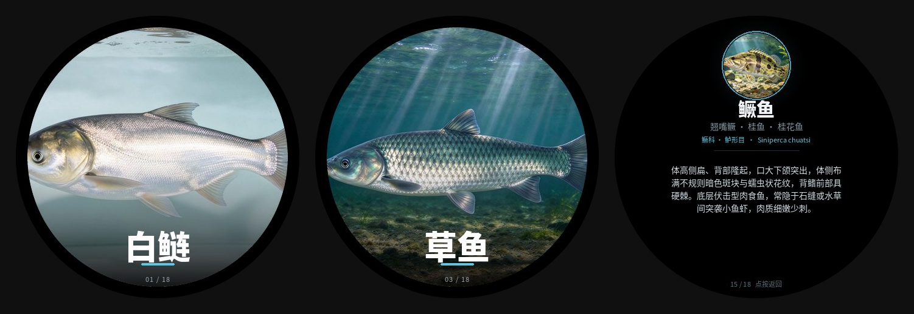

# 鱼图鉴 · ESP32-S3 圆屏版

把 [长江流域淡水鱼图鉴](https://mrhuyaa.github.io/fish-atlas/)（18 种鱼）重排成 466 × 466 圆形 AMOLED 屏可用的双页卡片图鉴，跑在 **微雪 ESP32-S3-Touch-AMOLED-1.75C** 上，给小孩做科普用。

纯黑底 + 满幅鱼图 + 压底鱼名，点按进详情；文字全部预渲染进图片，设备端不需要中文字库、不需要 HTML 解析，不联网、开机即显示。



> **下载完整包**：[Release v1.0.0](https://github.com/MrHuyaa/fish-atlas/releases/tag/v1.0.0)（`fish-atlas-amoled.zip` 源码 + 页面 + 资源镜像 + 一键烧录脚本；`littlefs.bin.zip` 单独的资源镜像）
> 用途、后续规划见 [readmez.md](readmez.md)。

## 交付物在哪

| 文件 | 大小 | 是什么 | 位置 |
|---|---|---|---|
| `fish-atlas-amoled.zip` | 6.95 MB | **完整工程包**：固件源码、36 张页面、18 张原图、渲染脚本、资源镜像、一键烧录脚本 | **Release 附件** |
| `littlefs.bin.zip` | 1.12 MB | **LittleFS 资源镜像**（解压后 8 MB 块设备镜像），内含 36 张页面，烧到 flash `0x310000` 后由板子挂载读取 | **Release 附件** |
| `configs/_template.json` | 1.1 KB | **换图鉴模板**：全部视觉参数 + 条目数据都在这一个 JSON 里，复制改名、填 `items` 即可生成另一套图鉴 | **本仓库** [`amoled/configs/_template.json`](configs/_template.json) |

> `littlefs.bin` 是二进制块设备镜像，不能用解压软件打开，也不建议手改；要改内容就重跑 `tools/render_atlas.py` 再重新打包。

## 完整包内的目录结构

以下结构指 **Release 里的 `fish-atlas-amoled.zip` 解压后**；本仓库只保留说明、模板与预览图，二进制大文件不入库。

```
fish-atlas-amoled/
├── fish_atlas/                  固件工程（PlatformIO）
│   ├── fish_atlas.ino           Arduino_GFX + JPEGDEC 直绘，不用 LVGL
│   ├── platformio.ini           32MB Flash / OPI PSRAM / 8MB LittleFS
│   ├── partitions.csv           3MB APP + 8MB 资源区
│   └── data/                    烧进 flash 的 36 张页面
├── tools/
│   ├── render_atlas.py          通用渲染器（配置驱动）
│   └── render_pages.py          早期固定版渲染（保留备查）
├── configs/
│   ├── fish.json                当前这套 18 条鱼
│   └── _template.json           模板（＝本仓库 amoled/configs/_template.json）
├── assets/fish/                 18 张原图
├── data/pages/                  渲染输出（466 × 466）
├── release/
│   ├── littlefs.bin             预打包资源镜像
│   ├── flash.sh / flash.bat     一键烧录脚本
│   └── README.md                烧录说明
└── preview/                     效果预览
```

## 快速开始

先下载并解压 Release 里的 `fish-atlas-amoled.zip`：

```bash
# 1. 编译固件
cd fish_atlas && pio run

# 2. 烧固件 + 资源（二选一）
pio run -t upload && pio run -t uploadfs

# 或者用预打包镜像（跳过 uploadfs）
cd ../release && ./flash.sh /dev/ttyACM0     # Windows 用 flash.bat
```

> 工程生成时未在实机验证过。第一次建议先烧官方 `05_LVGL_Widgets` 确认屏和触摸正常，再烧这个包；`1.75C` 的触摸复位脚若与 `board_config.h` 不一致，改 `fish_atlas.ino` 里的 `TP_RESET`。

## 换一套图鉴

```bash
mkdir -p assets/bird && cp ~/bird/*.jpg assets/bird/
cp configs/_template.json configs/bird.json     # 填 name/alias/family/latin/desc/img
python3 tools/render_atlas.py configs/bird.json
cp data/pages/*.jpg fish_atlas/data/
cd fish_atlas && pio run -t uploadfs
```

条数不用改代码：`FISH_COUNT` 跟随 `items` 长度即可。主题配色、卡片直径、字号等也都在模板 JSON 里（`theme` / `card` / `detail` 三段）。

## 交互

| 操作 | 效果 |
|---|---|
| 左右滑动 | 上一条 / 下一条（循环） |
| 点按 | 默认页 ⇄ 详情页 |
| BOOT 键 | 下一条（触摸失效兜底） |

## 后续规划

按同一套模板继续做常见鸟类、常见植物、汽车等图鉴，做成同一系列、同一套交互的科普小图鉴，详见 [readmez.md](readmez.md)。

## 图片与素材

鱼图与文字资料来自本项目的[网页版图鉴](https://mrhuyaa.github.io/fish-atlas/)，图片为 AI 生成的写实用图（原带「豆包AI生成」水印，网页版已去除）。整套内容仅供个人科普与硬件显示效果演示，请勿商用；如需商用请先替换或取得授权。

## License

代码部分 MIT。图片素材遵循上游版权说明。

---

<sub>部分技术说明由豆包 AI 生成并整理，硬件规格与报价未经实物复核。</sub>
